# C-Programming

### Оценка 3

**1. Смотрим на какой ветке находимся через `git status`**

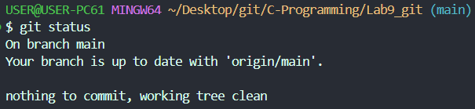

**2. Выводим `git log`**

**3. Создаем файл `sort.c` и вставляем туда функцию сортировки пузырьком**

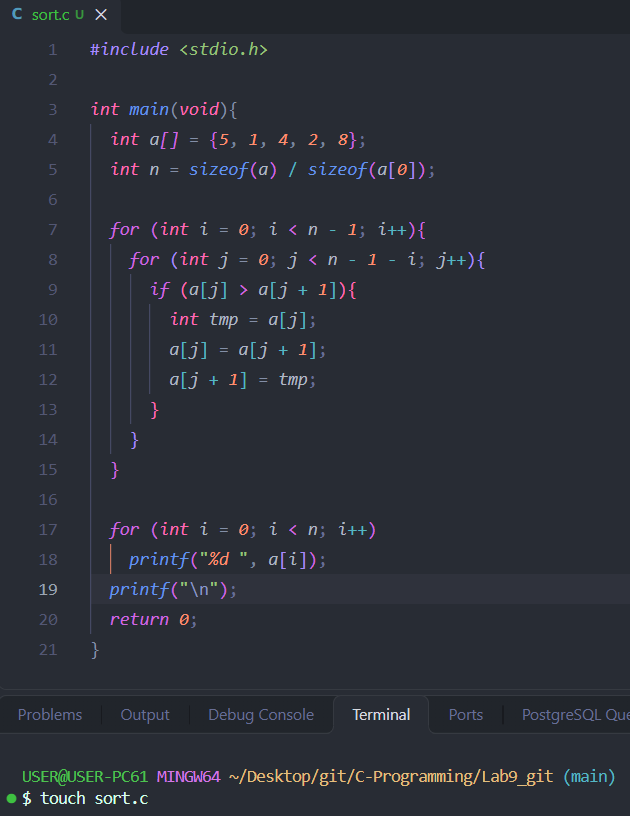

**4. Выводим `git status`**

**5. Добавим файл `sort.c` в stage**

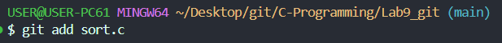

**6. Выводим `git status`**

**7. Коммитим файл `sort.c` в репозиторий**

**8. Выводим `git status`**

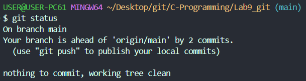

**9. Добавляем любой комментарий в файл `sort.c` ("Bubble Sort")**

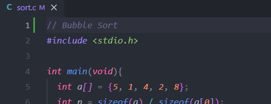

**10. Выводим `git status`**

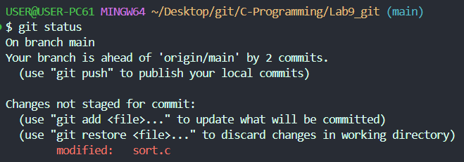

**11-12. Добавляем файл `sort.c` и выводим `git status`**

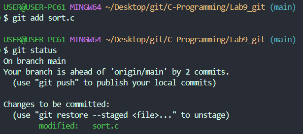

**13. Уберем добавленный ранее комментарий в файле `sort.c`**

**14. Делаем коммит**

**15. Выводим `git status` и смотрим журнал**

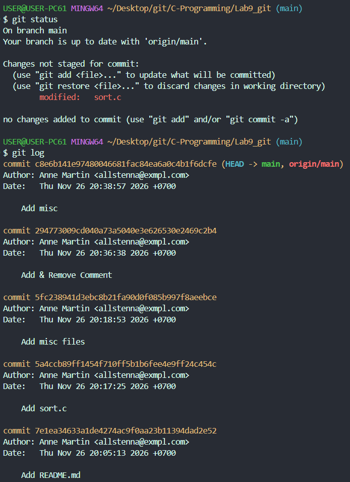

**16. Добавим в stage и закоммитим последнее изменение**

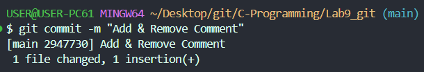

**17. Запушим на удаленный репозиторий через `git push`**

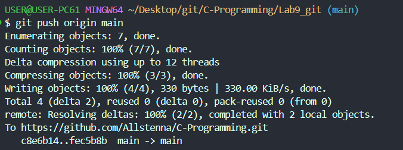

#### Branches

**1. Cоздадим новую ветку `mybranch` и перейдем на нее через `git checkout -b`**

**2. Используя `git branch`, увидем на какой ветке находимся**

**3. На основе предыдущего шага убедимся, что находимся на нужной ветке**

**4. При выводе `git status` заменяется название ветки на текущую (вместо main становится mybranch). Также это изменение видно в терминале VSCode и интерфейсе Git Bash**

**5-6. Создадим файл `file1.txt` и запишем туда одну строку с именем**

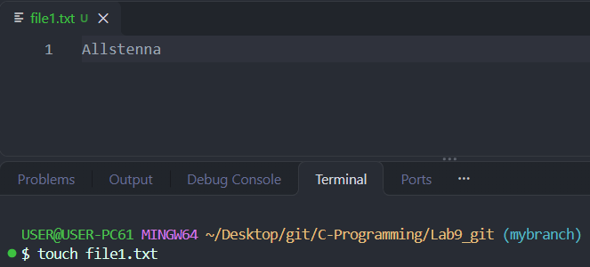

**7. Добавим файл `file1.txt` и закоммитем это изменение**

**8. Используя `git log --oneline --graph`, увидем, что ветка указывает на новый коммит**

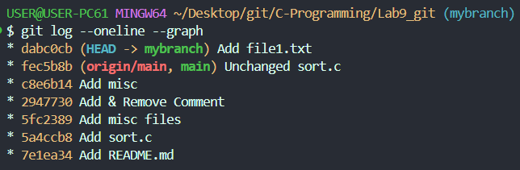

**9. Вернемся на ветку `main`**

**10. Используя `git log --oneline --graph`, увидем, что теперь коммит `dabc0cb` не отображается в последних коммитах ветки main**

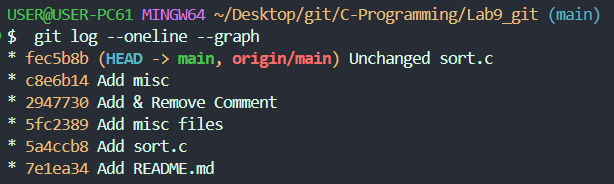

**11. Создадим новый файл `file2.txt` и закоммитем его**

**12. Используя `git log --oneline --graph --all`, увидем, что ветка указывает на новый коммит, и что теперь у двух веток разные коммиты**

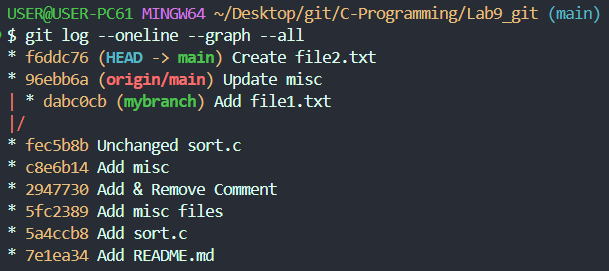

**13. Переключимся на ветку mybranch**

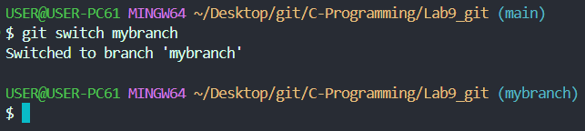

**14. Увидим, что файл `file2.txt` пропал из рабочей директории. Это произошло по причине независимости изменений в каждой ветке (изменения, закоммиченные в одной ветке, не затрагивают состояние других веток до момента их слияния)**

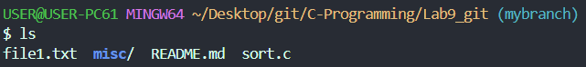

**15. Используя `git diff mybranch master`, увидим разницу между двумя ветками**

