# C-Programming

### Оценка 3

**1. Смотрим на какой ветке находимся через `git status`**

**2. Выводим `git log`**

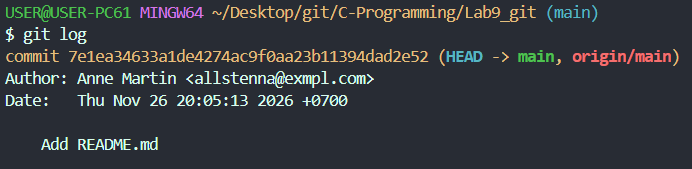

**3. Создаем файл `sort.c` и вставляем туда функцию сортировки пузырьком**

**4. Выводим `git status`**

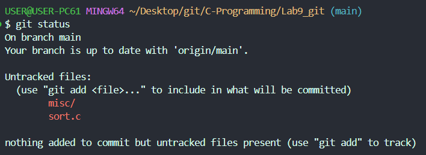

**5. Добавим файл `sort.c` в stage**

**6. Выводим `git status`**

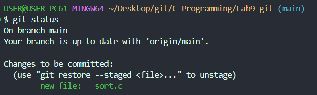

**7. Коммитим файл `sort.c` в репозиторий**

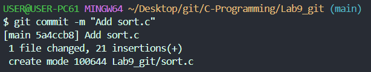

**8. Выводим `git status`**

**9. Добавляем любой комментарий в файл `sort.c` ("Bubble Sort")**

**10. Выводим `git status`**

**11-12. Добавляем файл `sort.c` и выводим `git status`**

**13. Уберем добавленный ранее комментарий в файле `sort.c`**

**14. Делаем коммит**

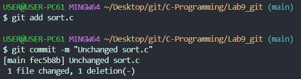

**15. Выводим `git status` и смотрим журнал**

**16. Добавим в stage и закоммитим последнее изменение**

**17. Запушим на удаленный репозиторий через `git push`**

#### Branches

**1. Cоздадим новую ветку `mybranch` и перейдем на нее через `git checkout -b`**

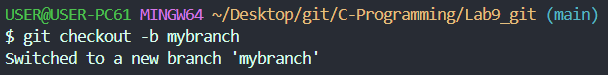

**2. Используя `git branch`, увидем на какой ветке находимся**

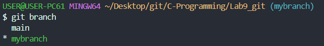

**3. На основе предыдущего шага убедимся, что находимся на нужной ветке**

**4. При выводе `git status` заменяется название ветки на текущую (вместо main становится mybranch). Также это изменение видно в терминале VSCode и интерфейсе Git Bash**

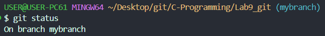

**5-6. Создадим файл `file1.txt` и запишем туда одну строку с именем**

**7. Добавим файл `file1.txt` и закоммитем это изменение**

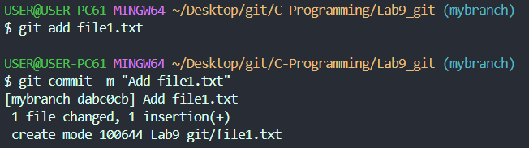

**8. Используя `git log --oneline --graph`, увидем, что ветка указывает на новый коммит**

**9. Вернемся на ветку `main`**

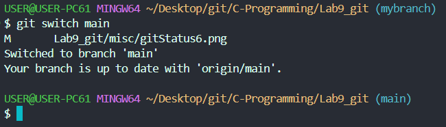

**10. Используя `git log --oneline --graph`, увидем, что теперь коммит `dabc0cb` не отображается в последних коммитах ветки main**

**11. Создадим новый файл `file2.txt` и закоммитем его**

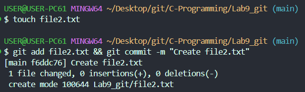

**12. Используя `git log --oneline --graph --all`, увидем, что ветка указывает на новый коммит, и что теперь у двух веток разные коммиты**

**13. Переключимся на ветку mybranch**

**14. Увидим, что файл `file2.txt` пропал из рабочей директории. Это произошло по причине независимости изменений в каждой ветке (изменения, закоммиченные в одной ветке, не затрагивают состояние других веток до момента их слияния)**

**15. Используя `git diff mybranch master`, увидим разницу между двумя ветками**

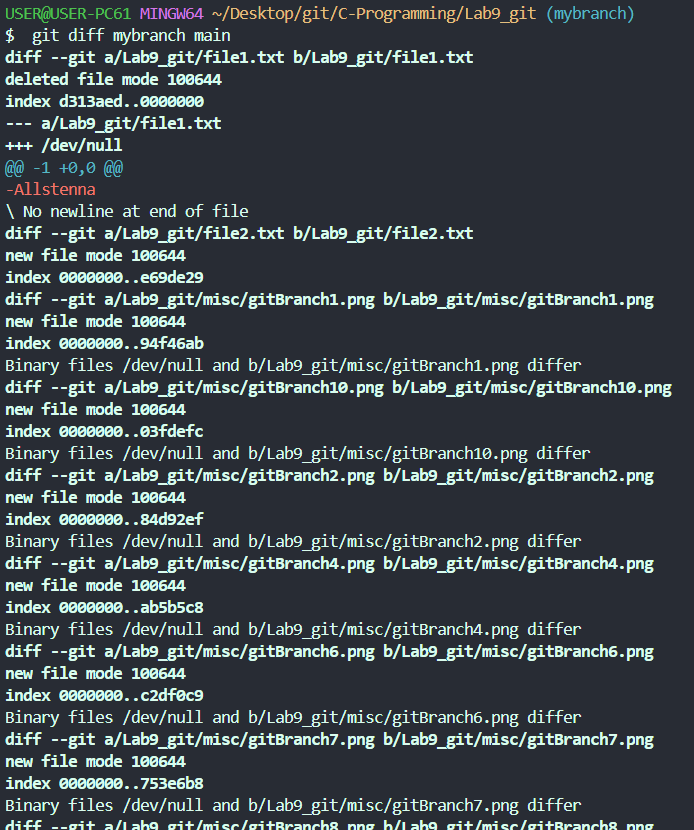

### Оценка 4

**1. Переключимся на ветку mybranch с помощью `git switch mybranch`**

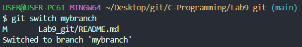

**2. Перезапишим содержимое в `sort.c` добавив функцию main(), в которой будет объявлен массив из нескольких чисел (int a[] = {4, 2, 0};) и вызвана функция сортировки для этого массива**

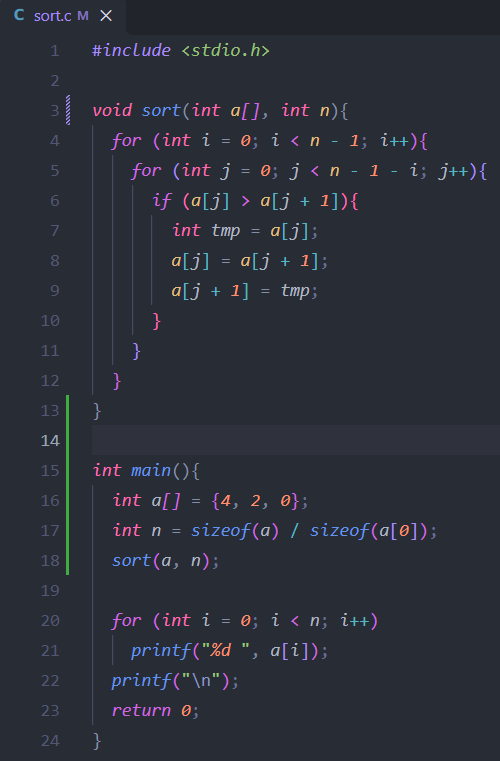

**3. `git diff` показывает, что в файле `sort.c` были изменены строки**

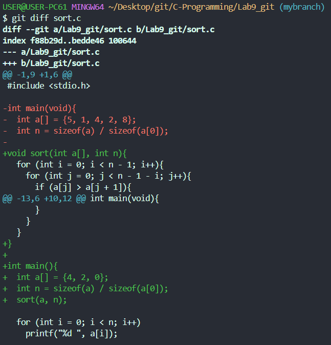

**4. `git diff --staged` ничего не выводит, так как в область индекса (stage) еще не было добавлено ни одного изменения с помощью `git add`**

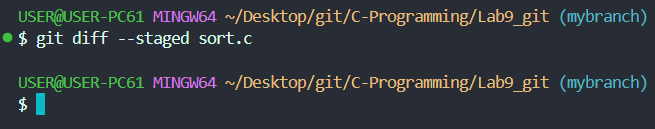

**5. Добавим в staged файл `sort.c` через `git add sort.c`**

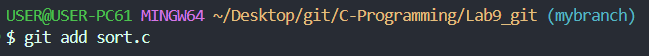

**6. `git diff` показывет, что разницы между stage и рабочей директории нет (поэтому вывод пустой)**

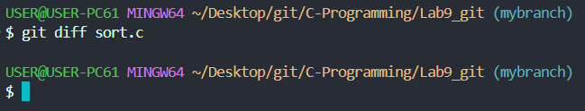

**7. `git diff --staged` выводит все внесенные изменения в файле `sort.c`, сравнивая текущее состояние области stage с последним коммитом в текущей ветке.**

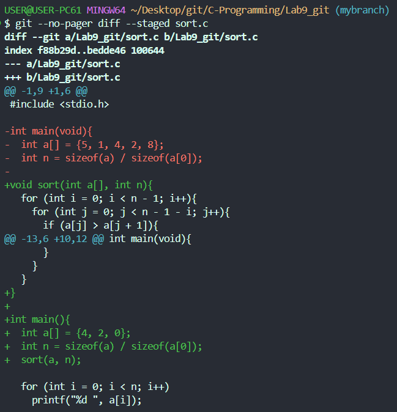

**8. Удалим любое из чисел в массиве в `sort.c`**

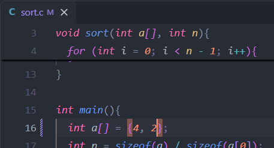

**9. `git diff` показывает разницу между областью stage и рабочей директорией: в файле `sort.c` строка "int a[] = {4, 2, 0};" заменилась на "int a[] = {4, 2};"**

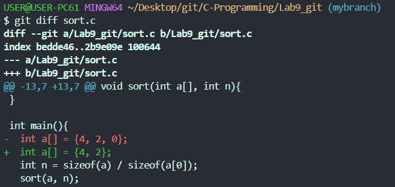

**10. `git diff --staged` показывает разницу между последним коммитом и областью stage: добавление строк с функцией `void sort(int a[], int n)` и вызов этой функции, а также изменение массива a**

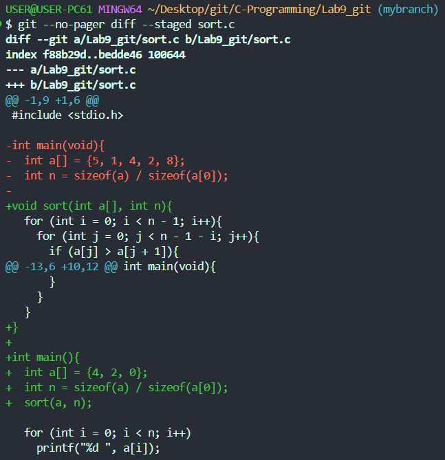

**11. Поскольку новая правка с {4, 2} еще не добавлена в индекс через `git add`, вывод `git diff --staged` остается прежним (сравнивает версию с {4, 2, 0} и исходный файл из последнего коммита), а `git diff` показывает изменения в файле с областью stage**

**12. Запустим `git status` и обратим внимание, что `sort.c` присутствует дважды в выводе**

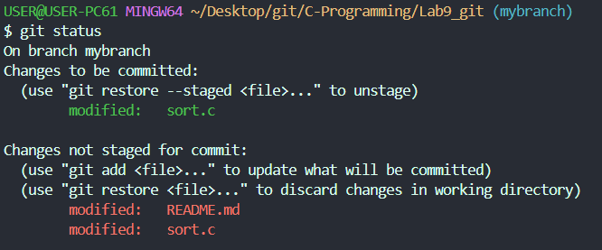

**13.Запустим `git restore --staged sort.c`, чтобы отменить индексацию изменения**

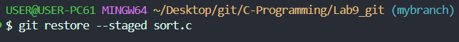

**14. `git restore --staged sort.c` убрала файл `sort.c` из области подготовки (stage), но при этом сохранила все изменения внутри самого файла**

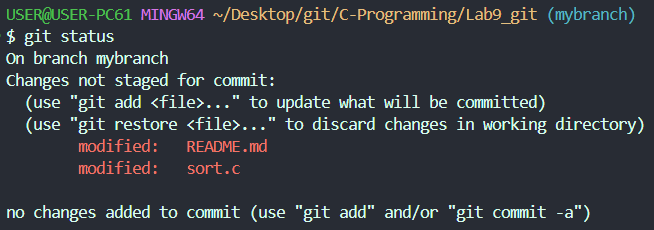

**15. Индексируем изменение (add) и делаем коммит**

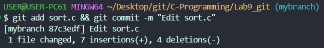

**16. В самом начале списка появился коммит `87c3edf...` с сообщением "Edit sort.c", который объединил в себе все изменения, сделанные в файле sort.c за предыдущие шаги.  Ветка mybranch (HEAD -> mybranch) теперь указывает на свежий коммит, тогда как удаленная ветка origin/mybranch осталась на предыдущем коммите "Upload report", так как еще не ,был сделан `git push`**

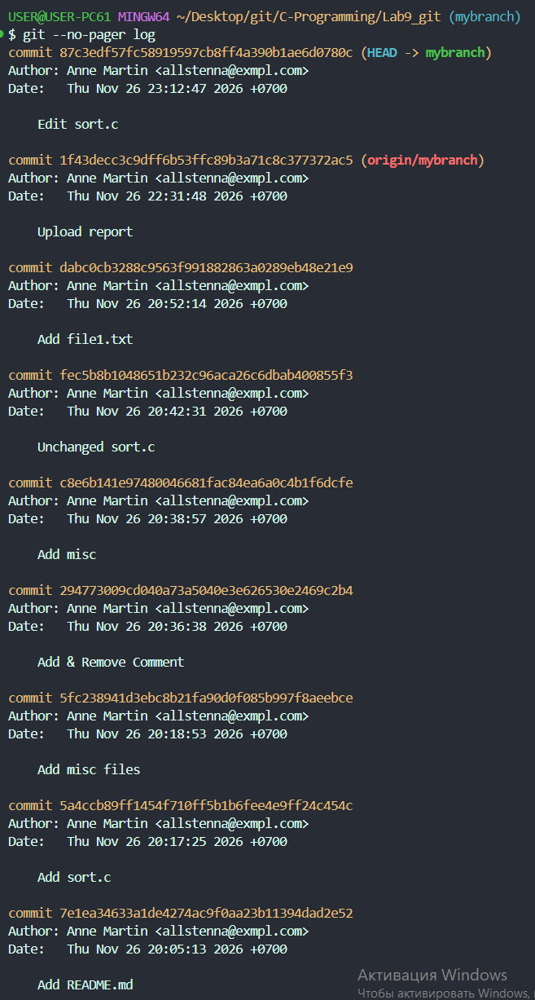

**17. Добавляем в `sort.c` в main() "printf(“hello git\n”);"**

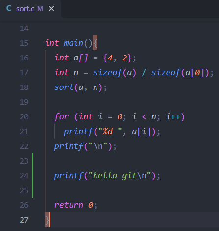

**18. Просмотрим содержимое `sort.c` через утилиту cat, где увидим добавленную строку**

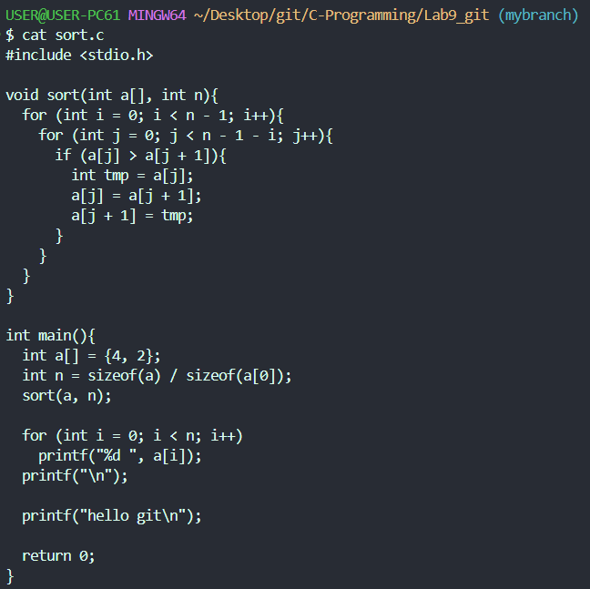

**19. При использовании `git status` видим, что Git зафиксировал изменение файла `sort.c` в рабочей директории, но оно пока не добавлено в stage**

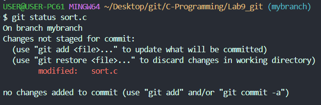

**20. Запустим `git restore sort.c`**

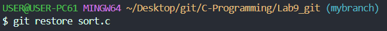

**21. Выведем содержимое `sort.c` через утилиту cat. Увидем, что добавленная ранее строка не отображается**

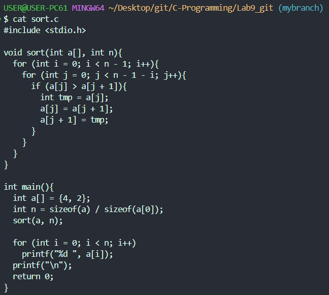

**22. `git status` показывает, что рабочая директория чиста, а все несохраненные изменения в файле `sort.c` полностью отменены**

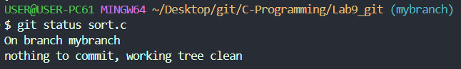

#### Branches & ff-merge

**1. Создадим файл `greeting.txt`, проиндексируем его и закоммитим с сообщением "Add file greeting.txt"**

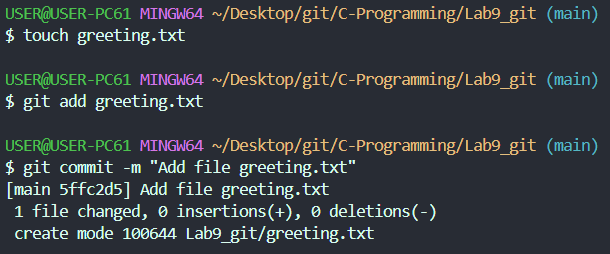

**2. Добавим в этот файл слово "hello", индексируем и коммитим с текстом "Add content to greeting.txt"**

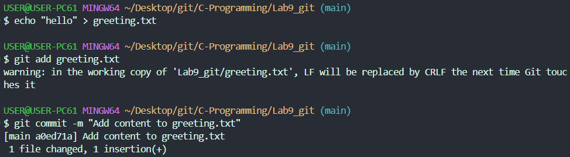

**3-4. Создадим ветку с именем feature/uppercase и переключимся на нее**

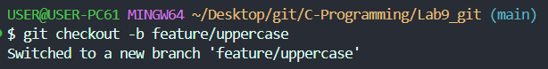

**5. `git status` показывает нам, что никаких изменений файлов, которые нужно закоммитить**

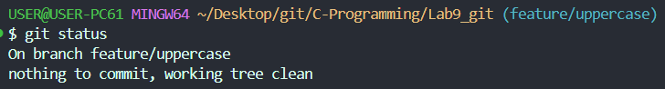

**6-7. Отредактируем `greeting.txt`, чтобы он содержал приветствие в верхнем регистре "HELLO", добавим файл `greeting.txt` и закоммитим его**

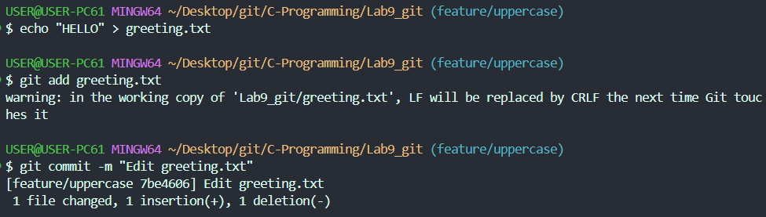

**8. Сейчас мы находимся на ветке feature/uppercase (можно проверить через `git branch`)**

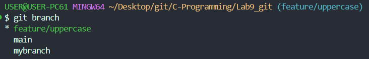

**9. Вывод команды `git log --oneline --graph --all` отображает полное дерево коммитов всех веток репозитория. Видно, что ветка feature/uppercase (на которую сейчас указывает HEAD) опережает ветку main на один коммит ("7be4606 Edit greeting.txt"), а также показано место ответвления параллельной ветки mybranch от общей истории коммитов.**

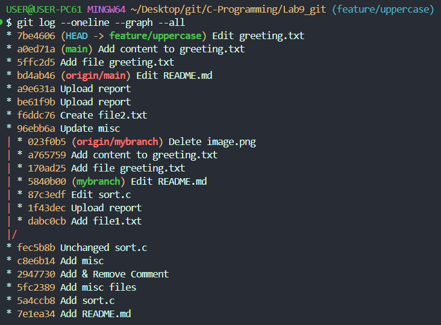

**10. Переключимся на главную ветку main**

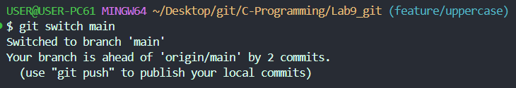

**11. Используя cat, увидим содержимое файла `greetings.txt`**

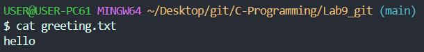

**12. По причине изолированности веток main и feature/uppercase могут иметь файлы с одинаковым названием, но с различным содержанием. Например, "greeting.txt" в ветке main содержит "hello", а в feature/uppercase - "HELLO". Для проверки можно воспользоваться командой `git diff main feature/uppercase`**

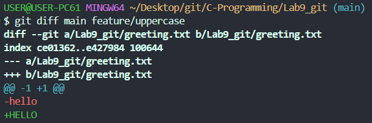

**13. Объединим ветку feature/uppercase с main**

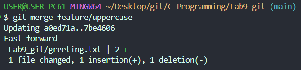

**14. Используя cat, увидим содержимое файла `greetings.txt`**

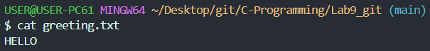

**15. Удалиv ветку с заглавными буквами (feature/uppercase)**

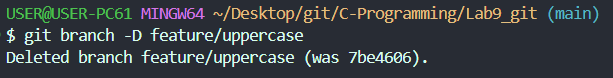

**16. Смержить ветку mybranch в main**

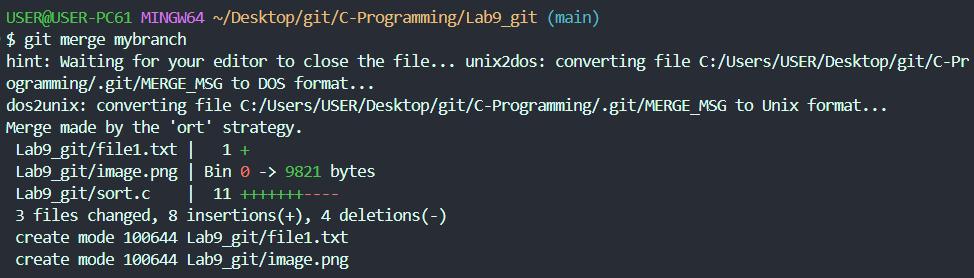

**17. `git log --oneline --graph --all` показывает, что коммит слияния b4a4534 (HEAD -> main) Merge branch 'mybranch' объединил историю ветки mybranch с главной веткой main. Изменения из ветки feature/uppercase (7be4606) включены в main, а сама метка feature/uppercase отсутствует на графе, так как ветка была удалена**

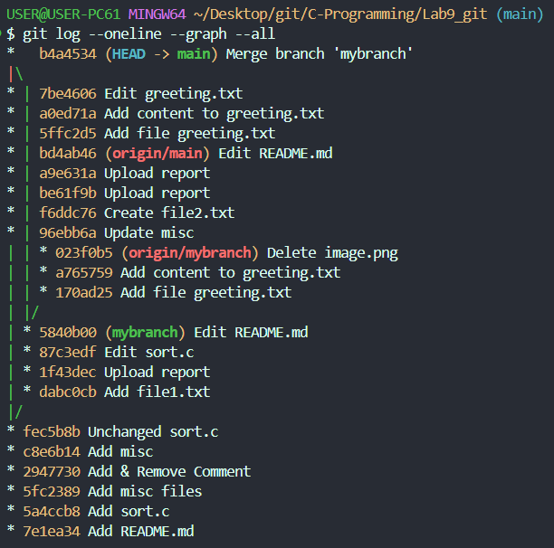

**18. Запушим изменения ветки master на удаленный репозиторий**

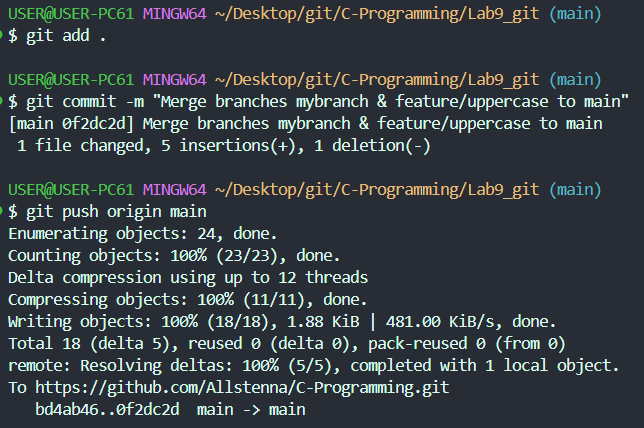